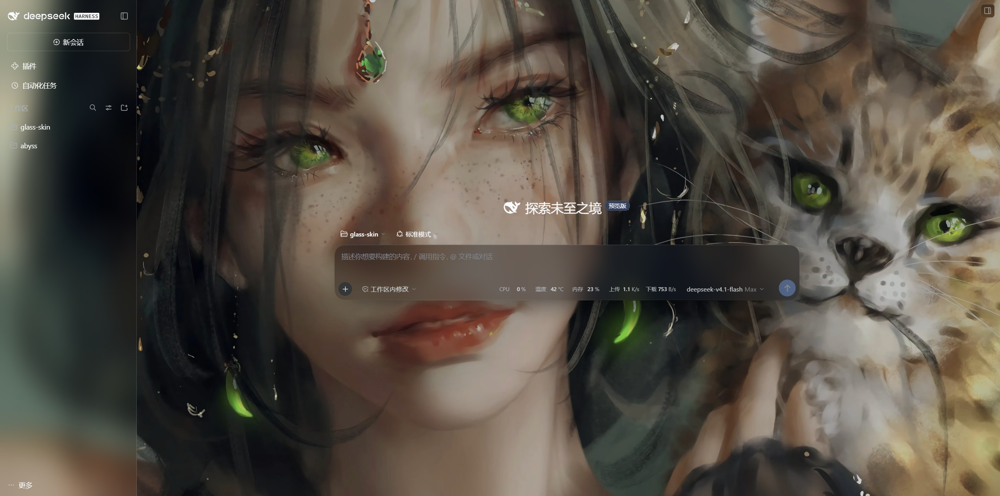
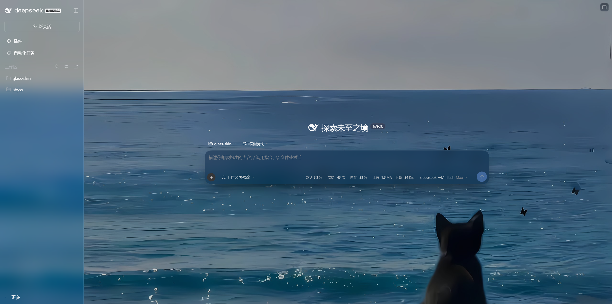

# glass-skin — Harness Web UI 透明玻璃皮肤

| 深色模式（默认） | 浅色模式 |
| --- | --- |
|  |  |

> 同一套配方，两种明暗：壁纸保持清晰，左侧栏展开时整列磨砂；「新会话」透明、只留 0.5px 边框；「插件」「自动化任务」这类整页内容进主区域时也补同一块磨砂。

## 用途

把 Harness Web UI 换成玻璃质感：极光渐变或自带图片作画布 + **磨砂控件**（半透明底 + 背景模糊 + 内发丝高光 + 投影）+ 一条细线分隔。

关键取舍：**壁纸保持清晰，磨砂只加在控件上**。画布不做 `filter`、不加颗粒；磨砂出现在悬浮于照片之上的控件（按钮、会话行、选项卡、输入框、输入框卡片、菜单与弹层、对话框遮罩）。纯客户端插件，卸载即完全还原。

## 安装与结构

- 本仓库即插件包：纯客户端 JS + CSS，没有构建步骤，Host 侧只有一个空的 `apply`
- 安装：用 Harness 的 `plugin_manager` 执行 `install_bundle`（`target` 指向本目录）。装好后是**目录链接**，改文件 + 刷新页面即生效，不需要重装
- 客户端模块：`client.js` 通过 `window.__ModuleLoader__.load` 注册；样式以 React `<style>` 渲染在 `shell.overlay` 插槽里（挂载即生效、卸载即移除）
- 卸载 / 回滚：`plugin_manager set_bundle enabled:false`（或 `remove_bundle`）。皮肤的所有写入都由插件自己的 effect 持有，卸载后主题与 DOM 自动复原

## 三层实现

1. **token 层**（`client.js` 里的 `TOKENS`）
   `ctx.theme.overrideTokens('glass-skin', {...})`，每个 token 是 `{ light, dark }` 一对。落点是 body 内联样式，所以覆盖所有 `--dsw-*` 变量，并跟随明暗切换。
   - 表面：`--dsw-alias-bg-base / bg-layer-1..3 / bg-overlay` 半透明
   - 侧栏、菜单、输入框、气泡：`--dsw-specific-sidebar-fill / -menu / -input-major / -bubble`、`--dsw-menu-surface-fill` 半透明
   - 弹层磨砂：`--dsw-menu-backdrop-filter`（40px + saturate）、`--dsw-mask-blur`（对话框遮罩 16px），底色回到 0.62/0.64 的玻璃浓度
   - 玻璃边：`--dsw-elevation-stroke-color` 改成白色高光发丝线；`--dsw-alias-border-l1..l4` 调成偏冷灰蓝

2. **样式层**（`client.js` 里的 `CSS`）
   负责 token 没有钩子的部分：
   - `body::before`：固定定位的画布（`z-index:-3`，在 body 的 isolate 栈上下文里，位于所有面板下方）。`background-image` 是 `var(--glass-wallpaper), var(--glass-aurora)` 两层，所以图片和极光可以互换，极光恒为兜底；54s 缓慢漂移；**不加 filter**，照片保持清晰
   - `body::after`：**唯一一层色调**（`z-index:-2`）。整站的"玻璃底色"只此一层，所以相邻区块不会因叠层数不同而出现接缝
   - `body :has(> [class*='_sidebarCol'])`：让 shell 框架不自绘底色（用 `:has()` 认领，避免和 chat/subagent 卡片的 `_frame` 撞名）
   - `_sidebarCol`：把 `--dsw-specific-sidebar-fill` 在该列重绑成 `transparent`，侧栏彻底裸照片（上游侧栏根元素原本铺这层，换掉就没有白纱了）；分隔只靠一条 `border-right: 0.5px solid var(--dsw-alias-border-l3)` 的普通细线，不用高光色、不加内阴影，所以不会发光
   - `[data-phase]` / `[data-content-phase]` / `_bottomRow` / `_tabHost` / `_emptyTabHost`：`background: transparent`。这些结构容器各自会再刷一遍 `--dsw-alias-bg-base`（10%），侧栏裸掉之后只剩主内容区有一层极淡的黑膜；统一透明后照片全屏一致，明暗只由 `body::after` 那一层决定
   - `_sidebarCol` 内的 `_fade`：`display: none`。workspace 列表贴着一条 `linear-gradient(transparent → sidebar-fill)` 的 24px 边缘淡出，在照片上就是一条发白的渐变条；列表本身会裁切，删掉不损失内容
   - `_composerSeat` / `_card`：输入框卡片 `backdrop-filter: blur(22px)` + 内高光 + 投影（它悬浮在照片上，属于控件）
   - **消息玻璃**（第 6 段）：发出的消息气泡（`[class*='_bubble']`）与接收到的助手步骤（`[data-chat-flow-kind='assistant-step']`，用数据属性而不是构建哈希类名）都加 `backdrop-filter` + 发丝高光 + 顶部反光；助手步骤是一张带内边距的玻璃卡
   - **展开面板玻璃**（第 4d 段）：左侧栏展开时（框架上没有 `data-sidebar-collapsed`）整列成为一块磨砂面板；右侧栏展开时（没有 `data-rightbar-collapsed`）同样。收起后两列保持裸照片 + 逐个控件的玻璃片。面板变玻璃后，面板内控件的玻璃片会自动撤掉，避免两层玻璃叠加。左右面板的浓度各自可调（见「展开的侧边栏」滑块），值经 `--glass-left-* / --glass-right-*` 落到 `linear-gradient` 的两个 stop 上
   - **控件玻璃**（第 8 段）：侧栏内的 `button / treeitem / tab / input / a`、`shell.bottom` 与 `shell.leading` 的按钮、`_header` 里的按钮，统一给 `backdrop-filter: blur(20px) saturate(175%)` + `inset 0 0 0 .5px` 发丝高光 + `inset 0 1px 0` 顶部反光 + 一层软投影；发丝用 inset 阴影画，不占布局
   - **新会话按钮透明描边**（第 8b 段）：左侧栏展开时，新会话按钮（`button[class*='_newSession']`）撤掉自己的底色 / blur / 发丝 / 投影，只留下它自带的 0.5px 边框，于是这一行读到的就是侧栏那一整块磨砂。上游原本给它铺 `--dsw-alias-button-elevated-fill`（浅色纯白、深色纯灰），那层才是唯一挡住磨砂的东西。hover / 键盘聚焦用原生 `--dsw-alias-interactive-bg-hover`（半透明），磨砂仍透出来。**只在展开的面板里生效**：侧栏收起成轨道后没有磨砂底可借，按钮照旧是第 8 段的玻璃片
   - **整页面板磨砂**（第 10 段）：主区域（`main` 插槽）平时是对话，点「插件」「自动化任务」这类入口后换成整页面板。判定办法：对话区域里一定有渲染器给的 `data-slot='main.conversation'` 锚点，没有它就是面板页。这类页面根部只铺 `--dsw-alias-bg-base`（10%）、卡片也是半透明，文字直接压在照片上读不清 —— 所以整列套上与展开侧栏同配方的磨砂：`blur(26px) saturate(170%)` + 同一条渐变（浓度跟随「展开的侧边栏 → 左侧」，也可用 `--glass-main-top/bottom` 单独覆盖）+ 顶部发丝。锚点在场时（对话）整列保持裸照片，聊天不受影响

3. **背景图片**（`client.js` 里的画布商店 + `BackgroundRow`）
   设置 → **玻璃皮肤**（独立设置页，`settings.section`，不再混在 General 的行里）：
   - **选择文件**：浏览器内用 canvas 压到最长边 2560px、JPEG 0.86，再存 localStorage（键 `glass-skin:wallpaper`），所以 12MP 的原图也不会撑爆配额
   - **用此 URL**：填 `https://…`（也接受 `data:`），回车或点按钮生效
   - **恢复渐变**：清空该键，回到内置极光

   有图时下方多一组滑块（拖动即时生效并持久化）：
   - **浓度**：色调层 alpha 0–80%，默认 44（键 `glass-skin:tint`）。照片太亮看不清字就往上调

   以及不分有图与否都存在的一组：
   - **展开的侧边栏**：左侧栏 / 右侧栏各一个 0–100% 的滑块（键 `glass-skin:left-panel` / `glass-skin:right-panel`，默认 20）。同一个数在深色里按 `×0.5`（20% → 0.10 白）、浅色里按 `×2.6`（上限 0.92，20% → 0.52 白）换算，因为深色面板只需很少的白就能读出"玻璃"；滑块 0 就是纯 blur 无底色

   选中图片后自动：画布**不再漂移**、**铺满整个视口**（`inset: 0` + `background-size: cover`，四边齐平，不会在边缘露出极光或色调的细缝；超出视口的部分按比例裁切）；色调层改成按滑块换算——深色取滑块值本身，浅色取滑块值 + 0.06（上限 0.90）。图片 data URL 超过约 3.8MB（`STORAGE_LIMIT`）时不写 localStorage，只在本次会话生效，刷新后回到渐变。

   > 踩过的坑：输入框外的粘性淡出层 `_composerSeat` 只在对话进行中（`data-phase=active|settling`）才有背景，空白会话是 `hero` 态；无条件给它铺渐变会在 hero 态糊出一整块深色矩形。现在规则与上游同相位，且完全不铺色——输入框卡片自己靠投影和边框与内容分开。

### 屏蔽官方「外观」

设置里那行 light / dark / system 由 ui-theme 注册在 `settings.general.item` 的 `appearance` 单元格。本插件用同一个 id 再注册一个渲染 `null` 的组件，把该单元格接管掉（slot 的规则是"复用已存在的 id 会替换那个 cell"），所以：

- 官方外观切换不再出现，主题固定用当前已存的首选项
- 卸载插件即自动还原（注册挂在插件 effect 上）

如果哪天需要它回来，删掉 `apply` 里那段 `settings.general.item / appearance` 注册即可。

### 皮肤自己的明暗开关

官方那行隐藏后，明暗改由「玻璃皮肤」页顶部的**外观**一组控制（深色 / 浅色两个按钮）：

- 点击即调用 `ctx.theme.setTheme('dark' | 'light')`，写的是官方偏好，所以**文字配色和玻璃配方同源**，不会出现"深色玻璃 + 浅色文字"的错配
- 页面通过 `ctx.on('theme/change')` 订阅解析后的 `active.colorScheme`，系统切模式时按钮状态也会跟着更新
- 每次调用 `setTheme` 都会正常持久化；官方 `appearance` 行仍然是隐藏的
- **默认深色不是写死的**：插件只跟随官方 `ui-theme` 偏好，部署配置里 `ui-theme.preference` 配 `dark` 就是深色。上面效果图分别是对应的明暗两套

### 为什么 `--dsw-alias-bg-base` 几乎是透明的

上游大量结构容器（frame / 对话 root / tab host / bottom row）都各自 `background: var(--dsw-alias-bg-base)`。一旦它是半透明，同一个界面里有的区域叠 1 层、有的叠 2~3 层，交界处就会出现"背景没衔接"的接缝。所以：底色透明度压到 0.10，真正的主色调交给 `body::after` 的单层色，结构容器保持透明。**改浓度要改 `--glass-tint-light/dark`，不是改这个 alpha。**

## 调参

只改 `client.js`，改完刷新浏览器页面即可（无需重装）：

| 想要 | 改哪里 |
| --- | --- |
| 更透 / 更实（整站色调） | `CSS` 里 `:root` 的 `--glass-tint-light` / `--glass-tint-dark` |
| 更透 / 更实（弹层、卡片例外） | `TOKENS` 里 `--dsw-alias-bg-layer-*`、`--dsw-specific-*` 的 alpha |
| 弹层更糊 | `--dsw-menu-backdrop-filter` 的 `blur()` |
| 换极光配色 | `CSS` 里 `:root` 与 `body[data-ds-dark-theme]` 的 `--glass-aurora` |
| 有背景图时的可读性 | 设置页的「浓度」滑块；或在 `GlassSkinStyle` 的换算里调偏移量 |
| 换背景图 | 设置 → 玻璃皮肤 → 选择文件 / 用此 URL（或直接改 localStorage 键 `glass-skin:wallpaper`） |
| 关掉动效 | 已在 `prefers-reduced-motion: reduce` 下自动停 |
| 新会话按钮恢复实底 / 换悬停色 | `CSS` 第 8b 段：删掉整段即恢复上游实底；悬停色改 `:hover` 里的 `--dsw-alias-interactive-bg-hover` |
| 面板页（插件 / 自动化任务）浓度 | 默认跟随「展开的侧边栏 → 左侧」；要单独调就设 `--glass-main-top` / `--glass-main-bottom` |

## 已知耦合与限制

- 样式层用类名子串选择器（`_composerSeat`、`_card`、`_bubble`、`_sidebarCol`、`_newSession`）。上游重命名这些 CSS Module 类时，对应特效会静默失效（不会报错、不会白屏），届时按新版类名改子串即可。
- 主区域是不是面板页，靠渲染器的插槽锚点 `data-slot='main'` / `data-slot='main.conversation'` 判断（数据属性比构建哈希类名稳）。插槽改名时第 10 段要跟着改。
- 系统开启「减少透明度」时，`prefers-reduced-transparency: reduce` 会自动撤掉壁纸和 blur。
- `blur` 层数已刻意限制在弹层、对话框、输入框、气泡四处；低配机若掉帧，优先去掉 `_bubble` 那条规则。
- 视觉验证需要人眼：类名子串和插槽锚点能静态核对，实际观感只能看页面。

## 版本管理

- 纯 JS + 纯 CSS，没有构建产物；`.gitignore` 只挡编辑器/系统垃圾与 `node_modules/`、`dist/`
- 提交 / 回滚不影响运行中的插件（安装是目录链接），要生效仍是改文件 + 重载 bundle（或刷新页面）
- 单文件回滚：`git log --oneline` 找提交 → `git restore --source=<sha> -- client.js`；工作区改动未提交时直接 `git restore client.js`
- 远端：`origin` 指向 GitHub 仓库（SSH），日常 `git push origin main`

### 分支策略

- `main`：唯一分支，可用版本与日常改动都提交在这里

当前工作分支是 `main`，插件实际加载的就是这个文件。
